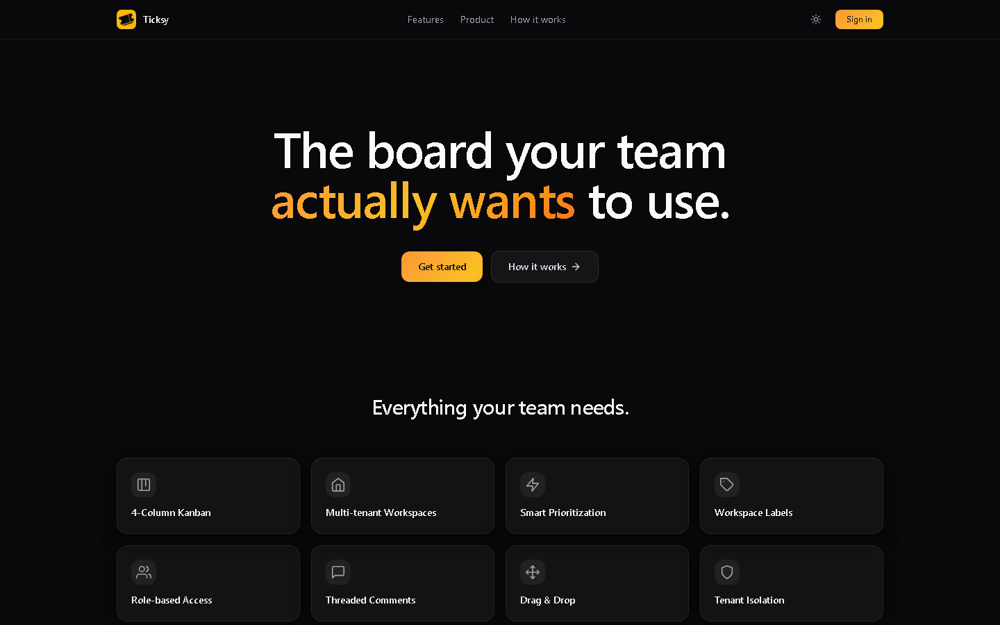
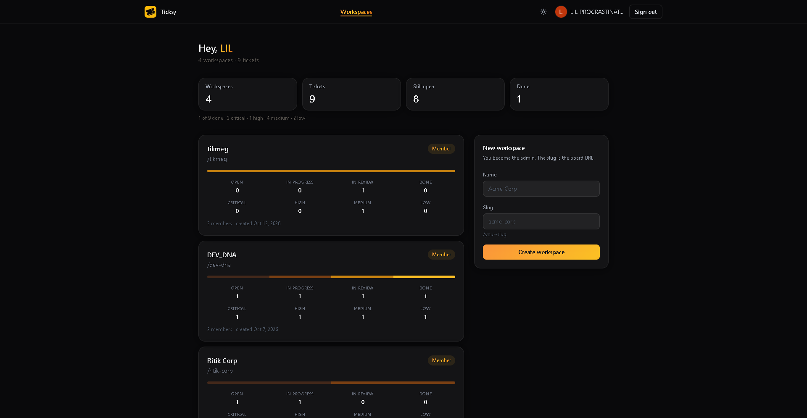
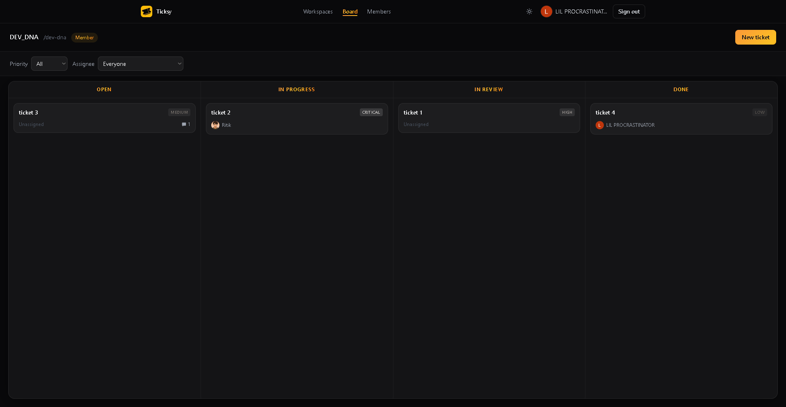
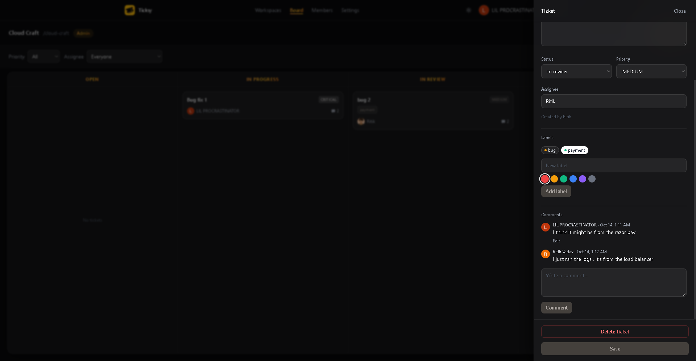
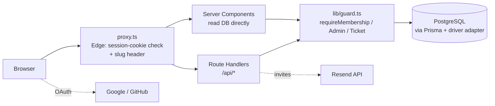
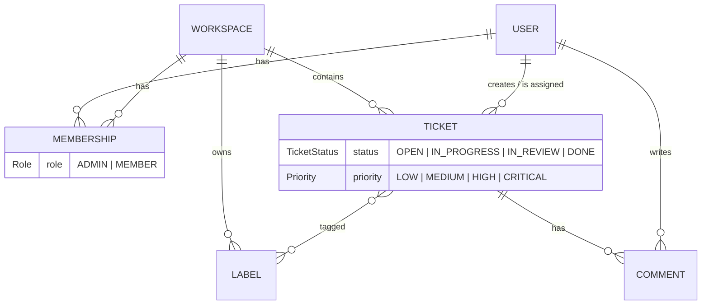

<div align="center">


# Ticksy

**A multi-tenant issue tracker with a drag-and-drop Kanban board, role-based access and email-bound invites.**

[](https://nextjs.org)
[](https://www.typescriptlang.org)
[](https://www.prisma.io)
[](https://neon.tech)
[](https://tailwindcss.com)
[](https://vitest.dev)

</div>

**Live demo → https://ticksy-lake.vercel.app/**


Ticksy is a Jira-lite built to be small enough to read in an afternoon and strict enough to trust with several teams' data. Each team gets an isolated **workspace**. Inside it, members move tickets across a board, discuss them in threads, and label and assign work. Admins manage people and settings.

The interesting part is not the board. It is how the app keeps one team's data away from another's: every request passes a guard, every query is scoped, and the failure responses are chosen so they don't leak anything. See [Design decisions](#design-decisions).

## Screenshots

Shown in the order a user meets them: landing page, workspace dashboard, board, then creating a ticket.

| 1. Landing page | 2. Workspace dashboard |
| :---: | :---: |
|  |  |

| 3. Kanban board | 4. New ticket |
| :---: | :---: |
|  |  |

## Features

**Board**
- Four-column Kanban (Open, In progress, In review, Done) with drag-and-drop built on `dnd-kit`.
- **Optimistic moves.** The card moves instantly. If the server rejects the change, the card goes back and an error shows.
- Filter by priority and by assignee, including "Unassigned".
- Ticket drawer for editing title, description, status, priority, assignee and labels, with a comment thread.
- **Ownership rules.** A ticket with an assignee can only be moved, re-prioritised or reassigned by that assignee or an admin. Cards you can't move aren't draggable, and the matching drawer fields are disabled. See [Who can change what](#who-can-change-what-on-a-ticket).

**Workspaces and people**
- Create any number of workspaces. One user can belong to many, with a different role in each.
- Two roles: `ADMIN` and `MEMBER`. Only admins can delete tickets, manage labels, invite people, remove members, or rename and delete the workspace. Members work on tickets within the ownership rules below.
- A workspace always keeps at least one admin. Removing the last one is rejected.
- Per-workspace labels with colours. Label names are unique inside a workspace but can repeat across workspaces.

**Invites**
- Admins invite by email. The link is a signed token that is **bound to that address** and expires after 48 hours.
- Sent through [Resend](https://resend.com) when configured. If it isn't, the admin gets a link to copy, so the feature still works in development.

**Accounts and polish**
- Sign in with Google or GitHub. Accounts that share a verified email are merged.
- Light and dark themes, saved per browser, with no flash on load.
- Dashboard with ticket counts by status and priority for each workspace.

## Architecture



Requests pass through two layers on purpose. The Edge proxy is cheap and only checks that a session cookie exists. It cannot call the database, because the Prisma adapter doesn't run on Edge. The real check, a database session plus workspace membership, happens in Node inside each page and route through the guards.

### Data model



`Membership` is the join between a user and a workspace and holds the role. A unique constraint on `(userId, workspaceId)` means the database itself prevents a duplicate membership, not just the application code.

## Design decisions

These are the choices worth discussing, and why they were made.

**Tenant isolation is enforced twice.**
A guard checks membership first (`requireMembership`, `requireAdmin`, `requireTicket`, `requireTicketAdmin`). Each query then still carries `workspaceId` in its `WHERE` clause. If a guard were ever skipped by mistake, the query still could not return another tenant's rows.

**Failure responses don't leak.**
A ticket that doesn't exist and a ticket in someone else's workspace both return `404`. A `403` would confirm to a stranger that the id is real. Label ids from another workspace get the same `400` as ids that don't exist, for the same reason.

**Database sessions, not JWTs.**
Sessions live in Postgres, so a session can be revoked server-side immediately. The cost is one lookup per request, and the proxy can't verify a session on its own (see [Architecture](#architecture)).

**Invites are signed tokens, not rows.**
No `Invite` table, no cleanup job, no extra query on accept. The token carries `{ workspaceId, slug, role, email }`, is signed with `HS256`, and the accept page requires the signed-in user's email to match. A forwarded link doesn't let a stranger in. The trade-off is that a single token can't be revoked before it expires. For a 48-hour link that was acceptable, and adding an `Invite` model later would remove the limit.

**Ticket edits follow ownership, not just role.**
The assignee is the person accountable for a ticket, so changing it is not free for everyone. The rule is below. Two choices behind it:

- *Unassigned tickets are open to every member.* Every new ticket starts unassigned. If only admins could move those, nobody else could pick up work.
- *Assigned tickets are protected.* One member can't quietly reassign, close or re-prioritise another member's work.

The policy lives in one pure file, `lib/ticket-permissions.ts`. The `PATCH` route enforces it, and the board and drawer import the same functions to disable controls. Hiding a control is cosmetic, because anyone can call the API directly, so the route is the real lock.

Two details that are easy to get wrong:

- *Only changed fields are checked.* The drawer sends every field on each save. A field counts as changed only if it differs from the stored value, so a member can edit the title of someone else's ticket without tripping the status rule.
- *The write is pinned to the assignee that was checked.* Two members can grab the same unassigned ticket at once. The update's `WHERE` includes the assignee that was read, so the loser gets `409` instead of silently overwriting the winner.

**Comments are edit-by-author only.**
Not even an admin can rewrite someone else's comment, because it would put words under another person's name. Admins can delete the whole ticket instead.

**Server Components read the database directly.**
The board page queries Prisma itself instead of calling its own API, which avoids an extra HTTP hop and hand-forwarding the session cookie. The API exists for client-side mutations and for anything outside the app.

**Input is validated at the edge of every route.**
Zod schemas parse every request body, strip unknown keys (so a client can't set `workspaceId` or `createdById`), and produce consistent `400` errors.

### Who can change what on a ticket

An **owned** ticket has an assignee. An **unowned** one doesn't.

| Action | Admin | Assignee | Other member |
| --- | :---: | :---: | :---: |
| Create a ticket, comment, add labels | yes | yes | yes |
| Edit title and description | yes | yes | yes |
| Assign an unowned ticket (to anyone) | yes | n/a | yes |
| Reassign or unassign an owned ticket | yes | yes | no |
| Change status of an unowned ticket | yes | n/a | yes |
| Change status of an owned ticket | yes | yes | no |
| Change priority | yes | yes | no |
| Delete a ticket | yes | no | no |

Rules are checked against the ticket as it is before the request applies, so one request can't unlock another field. To take an unowned ticket and then change its priority, assign it first, then save again.

## API

All routes require a session. Errors return `{ error }` with an appropriate status.

| Method | Route | Who | Purpose |
| --- | --- | --- | --- |
| `POST` | `/api/workspaces` | any user | Create a workspace (the creator becomes its admin) |
| `PATCH` `DELETE` | `/api/workspaces/[slug]` | admin | Rename, or delete (requires typing the slug) |
| `GET` `POST` | `/api/workspaces/[slug]/tickets` | member | List and create tickets |
| `GET` | `/api/tickets/[id]` | member | Read a ticket |
| `PATCH` | `/api/tickets/[id]` | member, with [ownership rules](#who-can-change-what-on-a-ticket) | Update a ticket. `403` if you don't own the field you're changing, `409` if the assignee changed while you were saving |
| `DELETE` | `/api/tickets/[id]` | admin | Delete a ticket and its comments |
| `GET` `POST` | `/api/tickets/[id]/comments` | member | Read and post comments |
| `PATCH` | `/api/tickets/[id]/comments/[commentId]` | author | Edit a comment |
| `GET` `POST` | `/api/workspaces/[slug]/labels` | member / admin | List labels, create a label |
| `PATCH` `DELETE` | `/api/workspaces/[slug]/labels/[labelId]` | admin | Edit or delete a label |
| `GET` | `/api/workspaces/[slug]/members` | member | List members |
| `DELETE` | `/api/workspaces/[slug]/members/[membershipId]` | admin | Remove a member (never the last admin) |
| `POST` | `/api/workspaces/[slug]/invites` | admin | Create and email an invite |

## Tech stack

| Layer | Choice |
| --- | --- |
| Framework | Next.js 16 (App Router, Server Components, Edge proxy) |
| Language | TypeScript |
| Database | PostgreSQL (Neon) through Prisma 7 with the `@prisma/adapter-pg` driver adapter |
| Auth | Auth.js (NextAuth v5) with the Prisma adapter, Google and GitHub providers |
| Validation | Zod |
| Drag and drop | `@dnd-kit/core` |
| Styling | Tailwind CSS 3 |
| Email | Resend HTTP API (no SDK) |
| Tests | Vitest |
| Hosting | Vercel |

## Getting started

**Prerequisites:** Node.js 20+, a PostgreSQL database (a free [Neon](https://neon.tech) project works), and OAuth credentials for Google and/or GitHub.

```bash
git clone https://github.com/ritik-2407/Ticksy.git
cd Ticksy
npm install            # also runs `prisma generate`

cp .env.example .env   # then fill in the values (see below)

npm run db:migrate     # apply migrations
npm run db:seed        # optional: demo workspaces, users, tickets
npm run dev            # http://localhost:3000
```

### Environment variables

| Variable | Required | Notes |
| --- | :---: | --- |
| `DATABASE_URL` | yes | Postgres connection string. |
| `AUTH_SECRET` | yes | Generate with `openssl rand -base64 32`. It also signs invite tokens, so rotating it invalidates outstanding invites. |
| `AUTH_URL` | yes | `http://localhost:3000` locally, your deployed URL in production. |
| `GOOGLE_CLIENT_ID` / `GOOGLE_CLIENT_SECRET` | one provider | Callback: `/api/auth/callback/google` |
| `GITHUB_CLIENT_ID` / `GITHUB_CLIENT_SECRET` | one provider | Callback: `/api/auth/callback/github` |
| `RESEND_API_KEY` / `RESEND_FROM` | no | Without both, admins get a link to copy instead of an email. |

### Scripts

| Command | What it does |
| --- | --- |
| `npm run dev` | Start the dev server |
| `npm run build` / `npm start` | Production build and server |
| `npm test` | Run the Vitest suite |
| `npm run lint` | ESLint |
| `npm run db:migrate` | Create and apply a migration |
| `npm run db:push` | Push the schema without a migration |
| `npm run db:seed` | Reset the database to demo data |
| `npm run db:studio` | Open Prisma Studio |
| `npm run db:reset` | Drop everything and re-apply migrations |

> `db:seed` and `db:reset` delete data. Never point them at a database you care about.

## Testing

```bash
npm test
```

The permission guards are tested without a database by stubbing Prisma. The tests assert the exact status each situation must return:

- `401` with no session
- `403` for a non-member, or for a member attempting admin work
- `404` for a missing ticket and for a ticket in another workspace

The ticket edit policy has two more suites:

- `ticket-permissions.test.ts` checks the rules as a table, covering admin, assignee and other member against owned and unowned tickets. It includes the edge cases: resending an unchanged field is not a change, and `null` is a real value.
- `ticket-patch.test.ts` calls the real `PATCH` handler over stubbed Prisma. It proves the status codes (`403` for a field you don't own, `200` for title and label edits), that a refused request never reaches the write, and that losing an assignment race returns `409`.

Other tests cover board filtering, callback-URL sanitising (rejecting off-site redirects) and invite tokens (the email is stored in lowercase and matched case-insensitively).

## Project structure

```
prisma/
  schema.prisma          data model
  migrations/            SQL migrations
  seed.ts                demo data
src/
  proxy.ts               Edge session guard + workspace slug header
  auth.ts                Auth.js configuration
  app/
    (auth)/sign-in/      branded sign-in page
    (app)/[slug]/        board, members, settings
    api/                 route handlers
    invite/accept/       invite acceptance
  components/
    kanban/              board, columns, cards, drawer, dialogs
    members/ settings/   admin screens
    landing/ shell/      marketing page, header, theme
  lib/
    guard.ts             authorization guards
    ticket.ts            shared ticket shape + assignee/label checks
    ticket-permissions.ts  who may change status, priority, assignee (shared by API and UI)
    invite.ts            signed invite tokens
    mail.ts              Resend client
tests/                   Vitest suites
```

## Deploying

1. Create a Postgres database (Neon) and set `DATABASE_URL`.
2. Import the repo into Vercel and set the environment variables above, with `AUTH_URL` set to the production URL.
3. Add the production callback URLs (`/api/auth/callback/google`, `/api/auth/callback/github`) to your OAuth apps.
4. Apply migrations against the production database with `npx prisma migrate deploy`.

`postinstall` runs `prisma generate`, so Vercel builds work without extra steps.

## Known limitations

Listed up front so they aren't a surprise.

- **Order inside a column isn't saved.** There is no position column, so cards sort by last update.
- **Invite tokens can't be revoked** before the 48 hours are up (see [Design decisions](#design-decisions)).
- **No text search** yet. Filtering is by priority and assignee only.
- **No real-time sync.** A second user sees changes after a refresh. Because of the ownership rules, a stale board can show a card as movable that was reassigned a moment ago. The server is the authority: the move is refused with the reason and the card snaps back.
- **No audit trail.** Assignment and status changes aren't recorded, so you can't see who reassigned a ticket or when.

## Roadmap

- Full-text and semantic search, with duplicate-ticket detection
- AI-assisted ticket creation and triage
- Persisted card order within columns
- Real-time board updates
- Invite revocation

## License

No license has been chosen yet. Until one is added, all rights are reserved.
